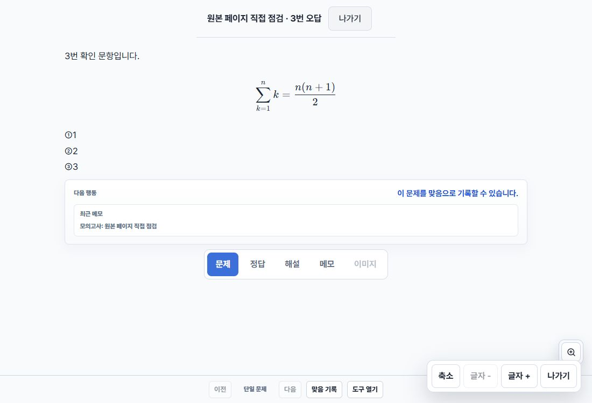
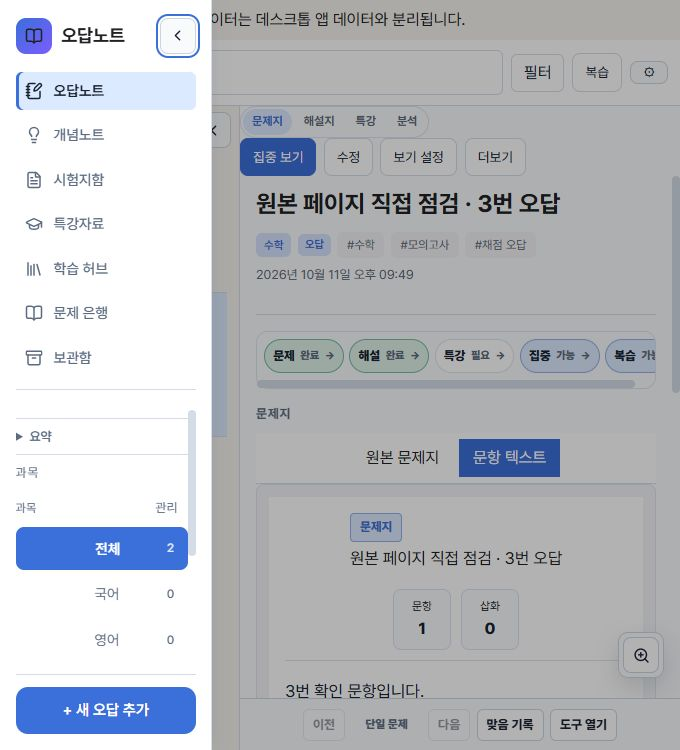

# 2026-10-11 최소 점검 후속 수정

## 기준과 범위

- 원격 main: `faaaa0fa1196e431077a4a96e0255552068b13e5`.
- 시작 기준: Draft #145 head `f117c7db489ce57c91d11643d3e75266f34dc2c0`.
- #145 위의 별도 브랜치에서 변경했다. #140, #141, #145 및 사용자 작업 폴더는 수정하지 않는다.
- 항목·시험·백업 저장 형식, 공개 API, 기존 주석 좌표는 변경하지 않는다.
- 메모리 제한에 따라 전체 unit/E2E/Rust/Tauri 검증은 보류한다. 설치판 교체와 병합은 범위 밖이다.

## 수정

### P1: legacy 이미지가 현재 이미지를 덮어쓰는 문제

`browserImageStore.ts`의 목록 조회가 legacy 값을 무조건 put해 현재 IndexedDB 값을 덮어썼다. 같은 readwrite 트랜잭션에서 목적지를 읽고, 없는 경우에만 put한다. 동일한 값은 이전 완료로 인정한다. 다른 값은 양쪽을 보존하고 목록/백업에 충돌 오류를 전달한다. 기존 파일을 임의로 선택하거나 이름을 바꾸지 않는다.

이전 트랜잭션이 확정된 뒤에도 legacy 값이 처음 읽은 값과 같은 경우에만 제거한다. 단일 이미지 읽기의 이전 경로에도 같은 조건부 이전을 적용해 다른 탭의 저장을 덮어쓰지 않게 한다. 충돌 해결 UI 및 자동 복구는 추가하지 않는다. 충돌이 있는 백업은 안전하게 중단되므로 원본 확인이 필요하다.

### P2: EXIF 회전 JPEG 거부

JPEG SOF의 원시 크기와 브라우저가 회전을 적용한 크기를 직접 비교했다. APP1/EXIF의 TIFF orientation을 범위 검사 후 읽고, 5~8에서는 기대 크기의 가로·세로를 바꾼다. 디코더에 `from-image`를 명시한다. 임의 크기 불일치는 계속 거부한다. 헤더와 디코딩 결과 모두 기존 치수·픽셀·출력량 제한을 통과해야 한다.

일반 추가와 ZIP이 사용하는 공통 프런트엔드 검증을 수정했다. Rust/proxy의 공통 검증은 원시 치수에 제한을 적용하고 실제 디코딩하므로 방향에 따른 치수 비교 오류는 없다(코드 검토). 네이티브 실행 검증은 보류했다.

### P2: 자동 오답 본문 일부 중복

표시용 파서가 `3번 확인 문항입니다.`의 `3번`을 문항 번호로 소비한 뒤, 남은 문장을 canonical 본문과 다른 legacy 문장으로 보충했다. 파서의 원문 범위와 저장된 canonical 텍스트를 대조해 해당 접두부가 본문에 포함된 것이 확인되면 그 범위를 그대로 정규화한다. 실제 번호가 canonical 본문에 없는 경우 기존 번호 분리와 선택지 추출을 유지한다.

일반·집중·복습에서 사용하는 공통 resolver를 수정했다. canonical ID·순서·조건·그림·표와 의도적인 반복 수식은 유지하며 저장된 문항을 재작성하지 않는다.

### P3: 좁은 화면의 사이드바 가림

768px 이하에서는 임시 접힘 상태로 시작한다. 명시적으로 펼치면 배경을 가리는 클릭 영역을 제공하고 바깥 클릭/Escape로 닫으며 토글에 포커스를 돌려준다. 열린 상위 dialog의 Escape는 가로채지 않는다. 모바일 조작은 넓은 화면용 localStorage 설정에 쓰지 않는다.

## 회귀 검사

- 이미지 충돌 시 양쪽 보존과 목록 실패, 동일 값, 누락 값, 중단 시 원본 유지, 이전 중 변경된 legacy 원본 유지.
- 기존 저장 확정/중단/삭제/이전 대기열 검사 유지. IndexedDB mock의 '키 없음'을 실제 API의 undefined로 맞췄다.
- 유효한 JPEG 방향 1~8, 관련 없는 디코딩 크기 불일치, 기존 손상/형식/치수 제한.
- 본문 시작의 `3번`/`3.`/`문제 3`, 실제 번호 분리, legacy 전용 문장, 반복 수식, 선택지.
- 좁은 화면 전환/임시 펼침/넓은 화면 설정 유지, Escape/바깥 클릭/포커스 복귀.

관련 8개 파일 54개 검사 통과. 최초 수정 전 JPEG 방향 5~8의 네 실패를 확인했다. 다른 두 오류의 재현 근거는 이전 직접 점검 보고서와 이번 관련 회귀 검사다.

## 최종 실행 및 직접 확인

- 독립 `npm ci --no-audit --no-fund`: 성공(285개 설치). 다른 작업 공간의 node_modules를 연결하지 않았다.
- 관련 Vitest 8개 파일 / 54개 검사: 성공. 전체 unit/E2E는 실행하지 않았다.
- 변경 TS/TSX 파일 전체 ESLint: 성공. 전체 src lint는 자원 사용 때문에 중단했다.
- `npm run build`: 성공. 기존 모듈의 정적/동적 import 혼용과 큰 번들 경고는 남아 있다.
- `npm run test:css-ownership`: 3개 성공. `git diff --check`: 성공.
- 실제 브라우저 JPEG 디코더: 방향 1~4는 120×60, 5~8은 60×120으로 디코딩되고 일반 `saveImageFiles` 경로로 모두 저장됐다.
- 격리 IndexedDB/localStorage에 같은 키의 다른 값을 둔 상태에서 목록 조회: 현재 `committed`와 legacy `legacy`를 모두 유지하고 충돌 오류를 반환했다.
- 실제 JSON 가져오기 UI에서 문항 3개와 정답 3개 저장 → 연습 응답 ①/③/② → 제출 → 정답 1/3, 자동 오답 1·3번 생성 → 3번 일반/집중 보기에서 본문 1회와 시그마·분수·선택지 표시를 확인했다.
- 원본 2페이지 넘김과 시험 문항에 따른 페이지 이동을 확인했다. 이 페이지와 점 연결은 임시 도구에서 저장 API로 주입한 확인용 자료다. 실제 PDF/ZIP UI 검증이 아니다.
- 1100×750 라이트 모드, 680×750에서 확인했다. 좁은 화면 기본 접힘·펼침·Escape·바깥 클릭·토글 포커스 복귀가 작동했고, 다시 1100px로 넓히면 기존 펼침 설정이 돌아왔다.
- 임시 자료와 확인 도구를 제거하고 점검용 서버·탭을 종료했다. 실제 사용자 저장소를 변경하지 않았다.

### 추가 관찰

자동 3번 오답은 원본의 두 번째 페이지 이미지를 올바르게 표시했으나, 축약된 1페이지 목록에서 “선택한 문항의 원본 페이지 연결이 없습니다” 안내가 나타났다. 원본 페이지 번호와 오답의 로컬 페이지 목록 대응을 추가 조사할 P2 후보로 남긴다. 텍스트 본문 중복 수정과는 별개이며, 이번 최소 수정에서 원본 연결 모델을 변경하지 않았다.

## 자원 제한과 미확인

독립 npm ci와 변경 TS/TSX 파일의 lint를 실행했다. 전체 lint는 약 1.2GB 사용 중 중단했고 통과로 기록하지 않는다. 전체 unit/E2E/Rust/Tauri 및 의존성 audit는 보류했다. `black 수학 8회.pdf` 전체 대조, 네이티브/proxy 실제 실행과 실제 터치는 미확인이다. 확인용 페이지를 실제 PDF 내용 검증으로 간주하지 않는다.

`entryPaneOverrides` 정리와 의존성 갱신은 별도 P3다. 전체 검사 완료 전 Merge-ready는 NO다.
