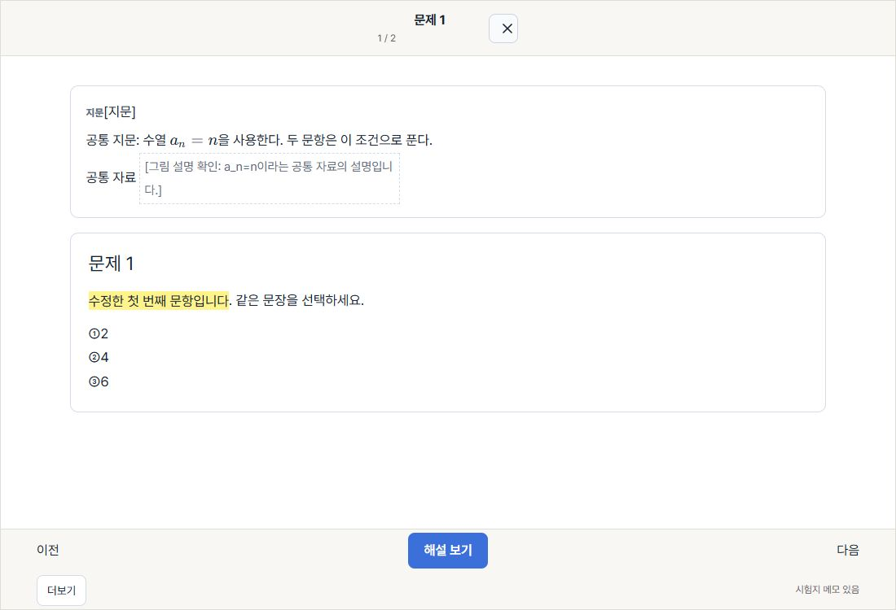
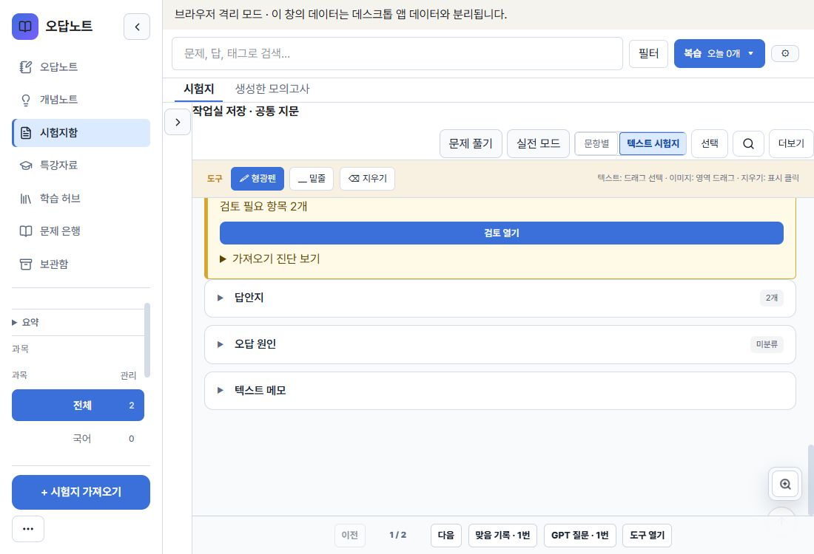
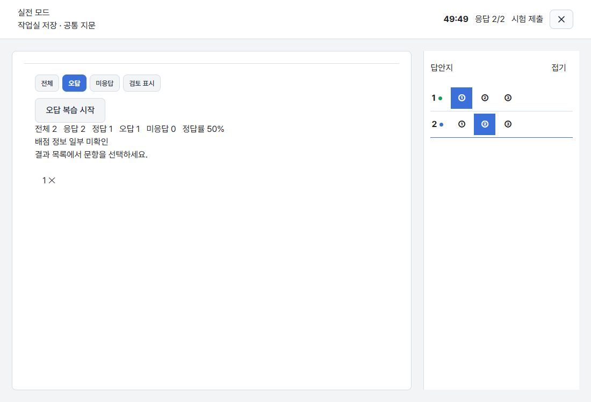
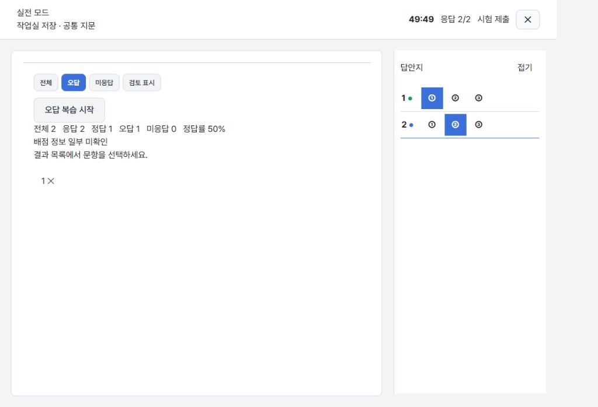
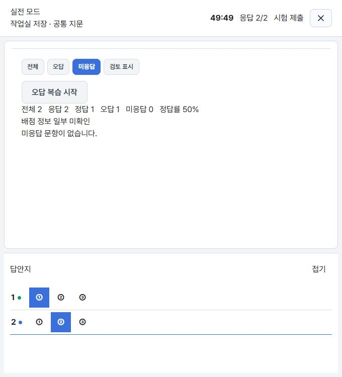
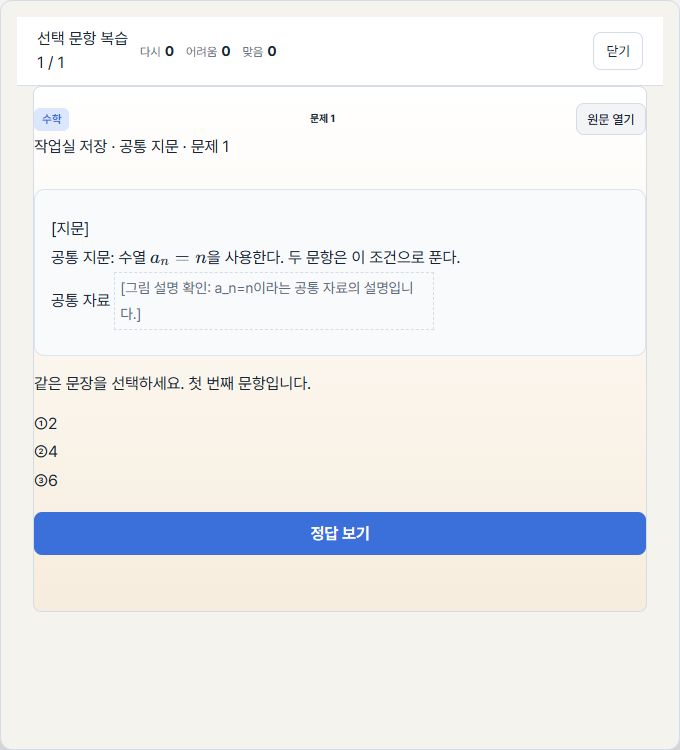
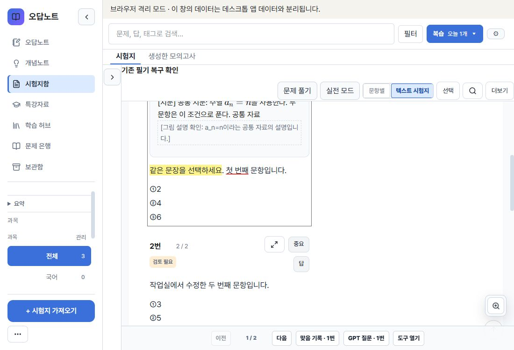

# 공통 지문·문항 필기·가져오기 메모 6건 수정

## 기준과 범위

- 2026-10-14 최종 fetch의 main: `cbe7f13d41cf4867366e91d684479013a8932591`.
- 미병합 Draft #152 head `7fca2e2d2a077d837e8767c3fce3e2f6aff7e8e0`에서 독립 작업 공간과 `codex/passage-annotation-integrity` 브랜치를 만들었다. 최신 main은 이미 포함된 상태였다.
- 이 PR은 #151·#152의 변경을 포함한다. 두 기존 PR은 수정·병합·종료하지 않았다.
- 사용자 원래 작업 폴더와 실제 데스크톱 저장 데이터는 보존했다. 독립 `npm ci`와 `VITE_STORAGE_MODE=isolated-browser`의 별도 localhost origin을 사용했다.
- 메모리 제약에 따라 로컬 전체 unit·E2E·계약·Rust·Tauri 검사를 실행하지 않았다. 이번 변경에서 테스트를 추가·삭제·skip하거나 기대값·제한 시간을 변경하지 않았다.

## 발견 사항 → 변경 → 직접 사용 결과

| ID | 원인과 수정 | 실제 확인 |
| --- | --- | --- |
| R01 / P1 | 바로 저장과 작업실 projection이 canonical 문항만으로 전체 호환 문자열을 다시 만들어 공통 지문과 원문 전용 그림 표식을 잃었다. `importSavePolicy`, `questionCompatibility`, `AppModals`, `importWorkspace`에서 기존 원문을 보존하고 유일한 문항 범위의 수정만 반영한다. 모호한 수정은 원문을 유지하고 검토 경고를 남긴다. | 공통 지문·`[FIGURE:shared-figure]`가 있는 2문항을 직접 저장 전 1번 수정, 작업실에서 2번 수정 후 저장. 두 경로의 실제 백업에 공통 지문·표식·수정한 본문이 함께 남았다. |
| R02 / P1 | 학습의 canonical 본문 투영에 공통 지문이 없었다. 기존 시험용 resolver를 `questionStimuli`로 공유하고 표시용 passage를 일반·텍스트 시험지·크게 보기·집중·복습·은행·시험에 전달한다. 지문에서 이미 표시한 그림을 본문 끝에 다시 붙이거나 잘못된 위치 경고를 내지 않는다. | 일반·텍스트 시험지·크게 보기에서 공통 지문과 설명 전용 공통 그림을 확인. 실전 응답→제출→오답 복습에서도 지문과 그림 설명이 본문 앞에 나타났다. |
| R03 / P2 | canonical 필기를 segment ID만으로 찾으므로 서로 다른 문항의 `body`가 충돌했다. 선택적 `canonicalQuestionKey`와 전체 문항의 앵커 유일성 검사를 추가한다. 기존 원문 좌표 주석도 유일한 원문 문항 범위로 제한한다. | 동일한 `body` ID를 쓰는 1·2번 중 1번에 형광펜을 작성. 1번에만 표시되고 2번에는 표시되지 않았다. 백업·복원 후 새 문항 키가 유지됐다. |
| R04 / P2 | 일반 canonical 카드가 주석 렌더러를 우회했다. 일반·텍스트 시험지와 크게 보기에서 동일한 AnnotatableQuestion·문항 context를 사용한다. 소유 문항을 판정할 수 없는 기존 canonical 주석은 자동으로 칠하지 않고 원문 보기와 명시적 문항 연결을 제공한다. | 크게 보기에서 작성한 필기가 일반·텍스트 시험지에 표시됐다. 복원한 모호한 기존 주석은 안내만 표시됐고, 사용자가 1번에 연결한 뒤 표시·지우기가 작동했다. 기존 raw 좌표의 밑줄은 1번에만 나타났다. |
| R05 / P2 | 작업실 entry projection에서 memo를 빈 문자열로 덮었다. memo와 지원하는 기존 메타데이터를 가져오기 draft에 유지한다. 함께 보존되는 이미지 주석은 파일명 변환·참조 보호에도 연결한다. | 작업실 저장 후 텍스트 메모와 실제 백업에 `작업실에서도 유지할 메모`가 남았고 복원 후에도 표시됐다. 이미지 주석 파일명 변환은 코드 검토·린트·빌드로 확인했으며 실제 이미지 필기 작성은 미확인이다. |
| R06 / P2 | 실전 결과 필터의 aria-pressed만 바뀌고 시각적 선택 스타일이 없었다. 공통 버튼 스타일과 선택·disabled·focus-visible CSS를 적용한다. | 1100×750, 1024px, 680px에서 오답 필터를 눌러 선택 버튼의 파란 배경·흰 글자와 필터 결과를 확인했다. |

## 추가 직접 확인

- 실전 2문항을 각각 오답·정답으로 응답해 제출: 응답 2, 정답 1, 오답 1, 정답률 50%. 자동 오답의 공통 지문과 선택 복습을 확인했다.
- 선택 복습에서 정답 확인·평가·완료 후 이어하기 창이 다시 열리지 않았다.
- 실제 PNG·JPEG가 든 기존 확인용 ZIP을 파일 입력으로 검증·바로 저장했다. 일반 보기의 조건→JPEG→다음 문장→prime 수식→표→선택지와 별도 Σ 식을 확인했다. 이미지 확대도 열렸다.
- 공유의 기본 정답 제외, 허용 확인 후 정답 포함, 옵션 해제 후 정답 제외를 실제 클립보드로 확인했다. 복사 흐름에서 MCP 동기화·ChatGPT 열기는 누르지 않았다. 이전 클립보드 내용은 복원했다.
- 실제 앱의 백업 생성·복원으로 공통 지문·메모·문항 키가 있는 새 주석과 기존 원문 좌표 주석을 확인했다. 백업 원본과 격리 점검 자료는 로컬 증거 폴더에 두었다.
- 직접 점검 뒤 임시 브라우저 탭과 Vite 서버를 닫고 viewport override를 해제했다.

## 호환성과 한계

- 기존 주석의 start/end, canonicalAnchors, 이미지 주석 형식은 유지한다. 새 필기의 `canonicalQuestionKey`만 선택적으로 추가하며 기존 필기의 일괄 이전은 하지 않는다.
- passage는 읽기 시 계산되는 표시 정보다. draft의 compatibilityText·originalQuestions와 metadata는 선택적 내부 필드이며 기존 초안도 읽는다.
- Rust는 annotations를 JSON 값으로 보관하고 workspace도 일반 JSON으로 읽으므로 선택 필드가 보존되는 코드를 확인했다. 네이티브 실행 검증을 대신하지 않는다.
- 이미 예전 저장 과정에서 사라진 지문·메모는 원본 가져오기 자료 없이 자동 복구할 수 없다. 원문 대응이 모호한 편집은 원문을 보존하므로 검토 안내가 남을 수 있다.
- 실제 PDF 전체, Windows native·proxy, 물리 터치·스크린리더, 이미지 필기 작성·삭제, 여러 segment에 걸친 선택, 작업실 문항의 그룹 이동·재정렬, 저장 장애 주입은 미확인이다. 일반 연습 시험 전체 흐름은 이번에 별도로 재실행하지 않았다.
- 기존 dependency audit 8건(낮음 1·중간 3·높음 4), 큰 bundle 경고와 `entryPaneOverrides` 정리는 별도 P3 작업으로 남긴다. lockfile은 변경하지 않았다.

## 최소 검사

- 독립 `npm ci`: 성공, 285 packages.
- 변경 TS/TSX ESLint: 오류 0, effect 관련 기존 경고 16.
- 최종 `npm run build` (`tsc -b && vite build`): 성공.
- `git diff --check`: 성공.
- 이 문서의 로컬 결과는 새 head의 GitHub CI 결과와 구분한다. GitHub CI는 PR 제출 후 확인한다.
- 전체 로컬 회귀·네이티브 확인을 보류했으므로 병합 준비 판정은 보수적으로 **NO**다. Draft로 제출하며 병합·설치판 교체는 하지 않는다.

## 화면 증거

