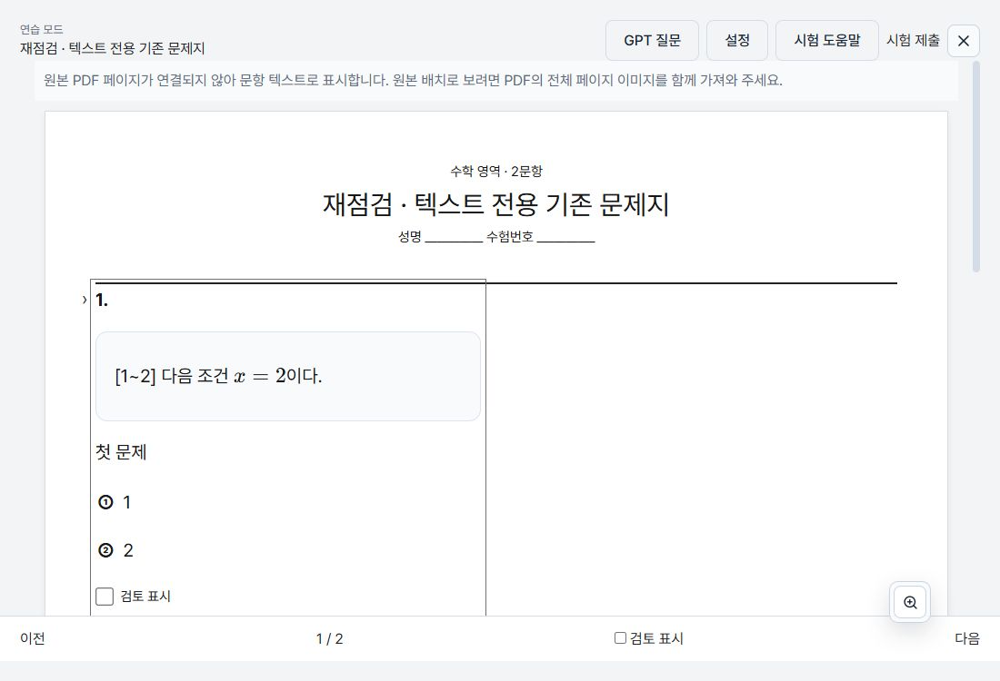
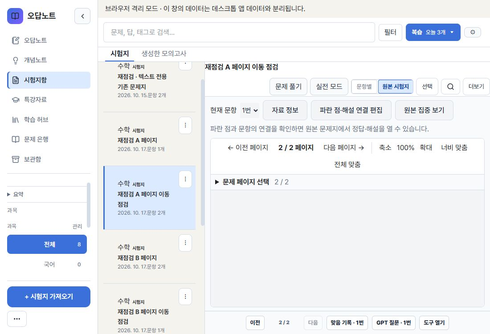
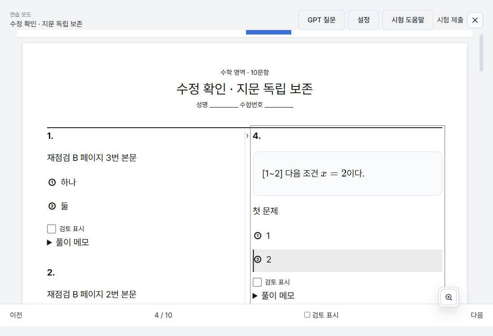
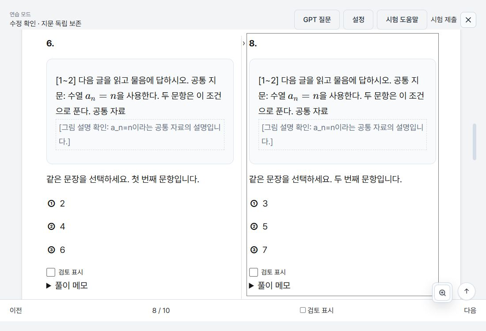
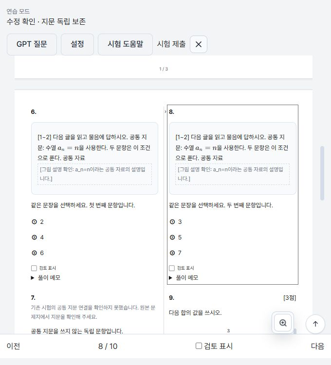

# #154 공통 지문·원본 페이지 연결 후속 수정

## 기준과 범위

- 최신 main `a79a42ef0d81ae797092f22e78133f2565a68cca`를 기존 #154 브랜치에 일반 병합했다. 충돌 없이 반영됐다.
- 작업 공간: `passage-annotation-integrity`, 브랜치 `codex/ranged-passages-solution-figures`.
- 사용자 작업 폴더·실제 데스크톱 저장 자료·#152는 변경하지 않았다.
- 기존 Draft #154만 보완한다. 병합·설치판 교체·entryPaneOverrides 정리는 범위 밖이다.

## 원인과 수정

| 발견 | 원인 | 변경 |
|---|---|---|
| 생성 시험의 지문·공통 그림 누락(P1) | 생성 경로가 legacy block으로 별도 snapshot을 만들며 passage·공통 그림을 빠뜨림 | 일반 시험의 snapshot 생성 부분을 `createExamQuestionSnapshots`로 분리해 재사용. 후보 선정·점수·순서는 유지하고 저장 내용만 canonical projection으로 맞춤 |
| 회차 이동 후 다른 페이지 연결(P1) | 문항 순서로 페이지 목록을 합치면서 각 자료의 source.page를 그대로 저장 | 각 문항의 원래 sourcePageAssets에서 자산을 찾고 최종 배열의 위치로 source.page를 재계산. 초안 원본은 불변으로 유지 |
| 연결 없는 현재 문항에 다른 원본 페이지 표시(P2) | 새 연습은 무조건 원본 보기, 문항 변경에도 이전 페이지·보기 상태 유지 | 최초·재개·문항 변경에서 현재 문항의 선택된 연결을 계산. 연결 없으면 텍스트·안내. 초기 reader에 다른 문항의 페이지를 넘기지 않음 |
| 기존 텍스트 자료의 지문 복구 거부(P2) | 원본의 없는 segments와 시험 생성 시 만들어진 body-1을 비교 | 동일 snapshot projection의 fallback segments와 비교. 내용 변경·중복 번호·시각·그림 충돌 보호는 유지 |

주요 파일:

- `src/features/exam/services/examSession.ts`: 공통 snapshot 생성 함수.
- `src/features/exam-builder/services/generateExam.ts`: 유일한 canonical snapshot·공통 지문·그림 보존, 자료 ID를 포함한 지문 그룹.
- `src/features/import-workspace/model/importWorkspace.ts`: 최종 페이지 인덱스와 crop 연결 재계산.
- `src/features/import-workspace/services/reorderQuestions.ts`: 이동 문항의 crop·확정 hotspot·후보도 해당 그룹으로 이동.
- `src/features/import-workspace/services/validateImportWorkspace.ts`: 잘못된 페이지 인덱스의 저장 차단 안내.
- `src/features/exam/components/ExamSessionPaper.tsx`: 문항별 원본/텍스트 상태 계산, 다른 문항 페이지 fallback 제거.
- `src/utils/sharedPassageRecovery.ts`: 기존 텍스트 자료의 동일 표현 비교.

새 생성 시험의 완전한 snapshot에는 지문이 없는 경우 기존 `passage`와 `stimulusGroupId` 문자열 필드를 모두 빈 값으로 명시한다. 이는 과거 snapshot에서 필드가 없어 지문을 수집했는지 모르는 경우와 구분하기 위한 것이다. 원본 삭제 후 독립 문항에 불필요한 지문 복구 경고가 붙는 것도 방지한다. 새 필드·스키마·마이그레이션은 추가하지 않는다.

## 재현 검사

수정 전 새 생성 시험 회귀 검사가 `snapshot.passage === undefined`로 실패함을 확인했다. 기존 CI의 두 실패도 그대로 유지한 뒤 수정했다.

관련 검사 파일:

- generateExam: 저장된 시험을 JSON으로 다시 읽고 원본 목록을 비워도 지문·공통 그림·그룹 유지. 독립 문항의 명시적 지문 없음 판정.
- sharedPassageRecovery: 기존 세션·오답 보충, 저장 객체·주석 불변, 실제 본문/segment 변경·중복 번호 거부.
- reorderQuestions: 회차 이동·재정렬 후 자산 대응과 초안 불변, crop·hotspot 이동.
- importWorkspace / validateImportWorkspace: 기존 변환·검증 동작.
- ExamSessionPaper: 연결 없는 첫 문항·같은 세션 내 변경·저장 선택 복원·대체 페이지·직접 페이지 이동.
- generatedExamSourcePageRegression: legacy 페이지 보충 및 원본 목록 변경 시 기존 snapshot 연결 보호.

기존 시험 전환 검사의 한 기대는 '연결 없는 새 연습도 원본 보기'였으므로 승인한 제품 정책에 맞춰 텍스트 보기를 검사하고, 별도의 연결 있는 새 연습은 원본 보기라는 검사도 추가했다. 테스트를 삭제·skip하거나 시간 제한을 늘리지 않았다.

최종 로컬 최소 검사 결과와 동일 head CI 상태는 PR 본문에 기록한다. 전체 로컬 unit/E2E/Rust/Tauri 검사는 메모리 제약에 따라 보류했다. 전용 node_modules를 그대로 사용했으며 이번에 npm ci를 다시 실행하지 않았다.

## 직접 사용과 저장 결과

localhost:1469의 격리 브라우저에서 확인했다. 백업 fixture의 초기 테마 설정을 확인한 후 라이트를 명시적으로 선택해 아래 화면을 다시 기록했다.

1. **기존 텍스트 시험 이어하기:** 본문·선택지가 동일한 세션에 `[1~2] 다음 조건 / x=2이다.`가 표시된다.
2. **회차 이동:** A(1번, A1.png), B(2·3번, B1.png)의 복구 초안에서 B 2번을 A로 이동 → 되돌리기 → 다시 실행 → 확정 저장. A의 1번 선택 시 자신의 2페이지로 이동한다.
3. **생성 시험:** 새 10문항 시험을 저장. 연결된 첫 문항은 1/10에서 시작하고, 연결 없는 4번을 선택하면 텍스트로 전환한다. 4번의 ② 응답 후 닫기·재개 시 4/10과 응답을 유지한다.
4. **원본 삭제:** 격리된 범위 지문 원본을 삭제한 상태에서 새 생성 시험 8번의 지문·공통 그림 설명이 유지된다. 앱 재로딩 후 재개에서도 8/10과 지문을 확인했다.
5. **저장 내용 대조:** UI로 내려받은 백업에서 생성 4·5번의 x=2 지문, 6·8번의 공통 지문과 shared-figure를 확인했다. 이동한 A 자료는 `[B1.png,A1.png]`, 문항 2는 page=1, 문항 1은 page=2다.
6. **화면:** 1100×750 라이트, 680×750 라이트의 지문·텍스트 표시와 시험 재개를 확인했다.

## 호환성과 남은 범위

- 항목·시험·주석의 공개 형식과 API는 유지한다. 기존 자료의 일괄 재작성은 없다.
- 이미 지문이 빠진 생성 시험은 안전하게 입증 가능한 기존 표시 복구를 계속 사용한다. 원본이 사라지거나 변경된 자료의 누락 내용을 추측해서 복원하지 않는다.
- 이미 잘못 저장된 source.page는 원래 대응 근거가 없으면 자동 교정하지 않는다. 이번 수정은 유효한 초안에서 새로 이동·저장하는 경로를 고친다.
- 공통 그림은 확인용 설명 자료로, 별도 문항의 실제 JPEG·수식·표도 같은 생성 snapshot 경로에서 표시되는 것을 확인했다. 실제 black 수학 PDF 전체 내용 대조·네이티브 인쇄·Windows/proxy·물리 터치·주석 작성/삭제 전체는 미확인이다.
- 저장 장애·삭제 유예 만료·이미지 참조 보호의 전체 재점검은 이번 최소 검증에 포함하지 않는다.
- 점검용 서버·탭은 정리하고 사용자 기존 브라우저 탭은 유지했다.

동일 head의 Frontend·E2E·Rust·Tauri가 모두 성공하기 전에는 Merge-ready NO다. Draft 상태와 미병합 상태를 유지한다.
