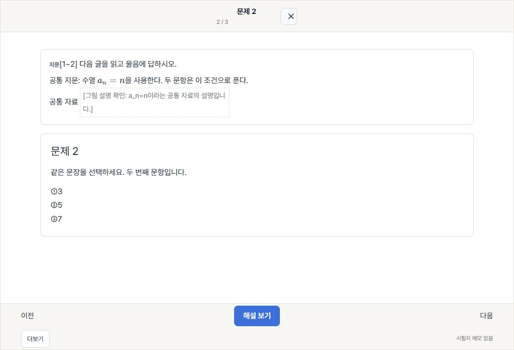
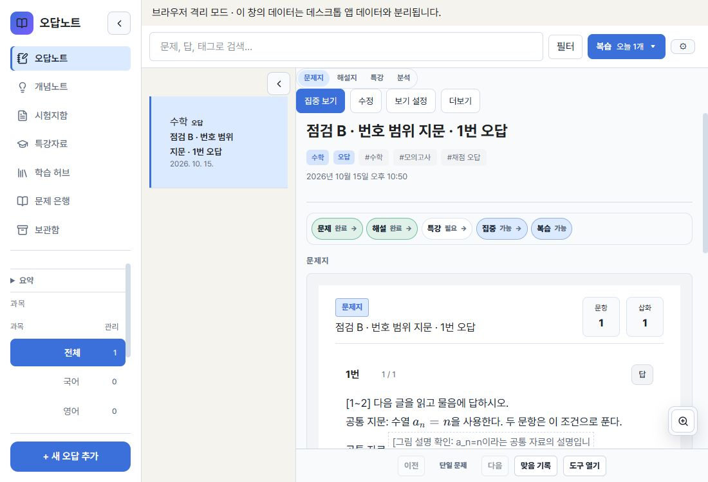
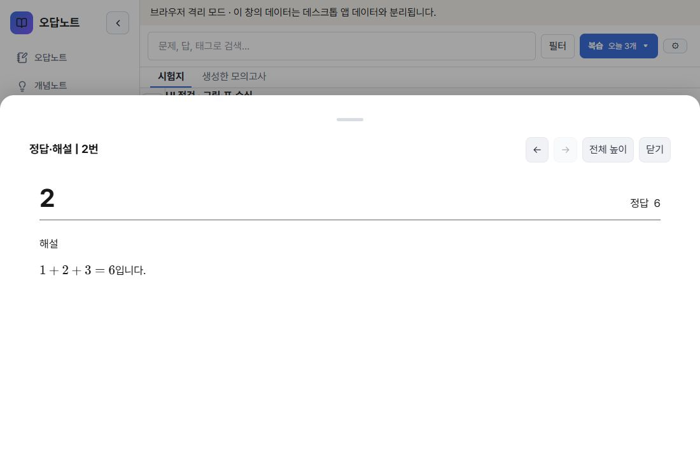

# 번호 범위 공통 지문과 해설 그림 수정

기준 main: `10f2f11f7ac36242447f13f741e697b578ba66ea`.
브랜치: `codex/ranged-passages-solution-figures`.
사용자 작업 폴더와 실제 데스크톱 데이터는 보존했다. 병합·설치판 교체는 하지 않는다.

## 문제와 수정

1. `[1~2] 다음 글…`의 공통 지문이 학습·시험·자동 오답·복습에서 누락됐다. 범위 머리말과 이름 없는 선행 지문을 공통 인식기로 처리하고, 범위의 모든 대상 번호가 유일하며 순서대로 존재할 때만 연결한다. 범위 밖의 3번에는 지문을 연결하지 않는다. 잘못된 범위·중복 번호는 원문 확인 안내로 처리한다. `[지문]`, `[자료]`, 표 머리말은 유지한다.
2. 다음 지문 머리말과 내용이 앞 문항의 마지막 선택지로 흘러들지 않도록 파서 경계를 맞췄다. 원문의 start/end 좌표는 유지한다.
3. 해설 렌더러가 자료 전체의 미참조 그림을 경고했다. 각 해설 부분에서 실제로 참조한 ID만 전달한다. 본문 전용·다른 문항·다른 풀이 단계의 그림은 불필요한 경고를 만들지 않으며, 실제 없는 ID·잘못된 표식의 경고는 유지한다.
4. 기존 시험·자동 오답은 표시용 복사본에서만 지문을 보충한다. 원본 ID/번호가 유일하고 본문·선택지·조건·수식·canonical 흐름이 일치하며 원본 갱신 시각이 시험 시작 이후가 아닐 때만 보충한다. 그림 ID 충돌은 거부한다. 일반·집중 보기·복습·문제은행·공유에 표시용 데이터를 전달하며 편집과 저장 대기열은 원본 데이터를 사용한다. 재개 시험을 제출해 새 오답을 만들 때는 확인된 지문을 새 오답에 포함한다.

공개 저장 형식 변경과 일괄 마이그레이션은 없다. 기존 원문 문자열·주석 좌표·시험 응답은 재작성하지 않는다.

## 직접 사용

localhost:1466의 isolated-browser 모드에서 확인했다. 1100×750 라이트 모드와 680×750 해설창을 사용했다.

- 번호 범위 지문과 그림 표식을 포함한 3문항 JSON을 실제 가져와 저장했다.
- 일반 보기에서는 지문을 한 번, 2번 단독 보기에서는 해당 지문과 그림 설명을 함께 표시했다. 독립 3번에는 지문이 없었다.
- 2번 GPT 도움 프롬프트에 공통 지문이 포함됐다. 외부 메시지·MCP 동기화는 실행하지 않았다.
- 일반 시험에 응답 3개를 입력하고 제출했다. 정답 1/3, 자동 오답 2개가 생성됐고 오답 복습에서 지문이 표시됐다.
- 실제 백업 파일에서 새 자동 오답 1·2번의 원문과 첫 canonical segment에 공통 지문이 저장된 것을 확인했다.
- 기존 지문 누락 오답을 보충하는 확인용 백업을 복원해 일반·집중 보기에서 지문이 표시되는 것을 확인했다. 이 백업은 이전 점검 자료를 복제하고 원본을 시험 이후 수정하지 않은 상태로 구성한 fixture다.
- 다시 내보낸 백업을 대조해 기존 오답 객체가 그대로이고 기존 시험 snapshot에도 passage가 새로 기록되지 않았음을 확인했다.
- 원본의 updatedAt이 시험 이후인 이전 점검 기록에는 원문 확인 안내가 표시됐다. 복습 평가만으로 updatedAt이 변경된 자료도 보충을 거부할 수 있다. 이전 지문 내용의 동일성을 증명할 수 없으므로 보수적으로 처리한다.
- 실제 PNG/JPEG가 있는 원본 페이지의 파란 점에서 1번→2번 해설을 열었다. 이전의 `fig1` 연결 경고가 사라졌고 680px에서도 정답·해설이 표시됐다.

직접 확인 원본·백업·추가 화면은 `C:/Users/reda0/.codex/tmp/ranged-passages-fix-2026-10-17`에 보관했다.

## 검사와 제한

- 변경 파일 ESLint: 처음 실행 오류 0, 기존 effect 경고 9. 최종 변경 파일 결과는 PR 설명에 기록한다.
- 최종 `npm run build` 성공(tsc 포함). 기존 번들 크기 및 정적/동적 import 경고가 남는다.
- `git diff --check` 성공.
- 새 범위 지문/해설 그림 검사 16개는 통과했다. 같은 실행의 기존 examSession/textLayout 두 파일은 Windows Vitest forks worker가 시작되지 않아 오류가 발생했다. 전체 실행은 성공으로 간주하지 않는다. 이후 추가한 기존 기록 표시 복구 검사 3개는 CI 검증 대상이다.
- 메모리 제한으로 전체 로컬 unit/E2E/Rust/Tauri 검사를 보류했다. timeout 증가·skip·기대값 완화로 worker 오류를 덮지 않았다.
- 실제 PDF 전체, Windows native/proxy, 물리 터치, 스크린 리더, 주석 작성·삭제 전체는 미확인이다.
- 동일 head GitHub CI 성공 확인 전 Merge-ready NO. 새 PR은 Draft로 유지한다.
