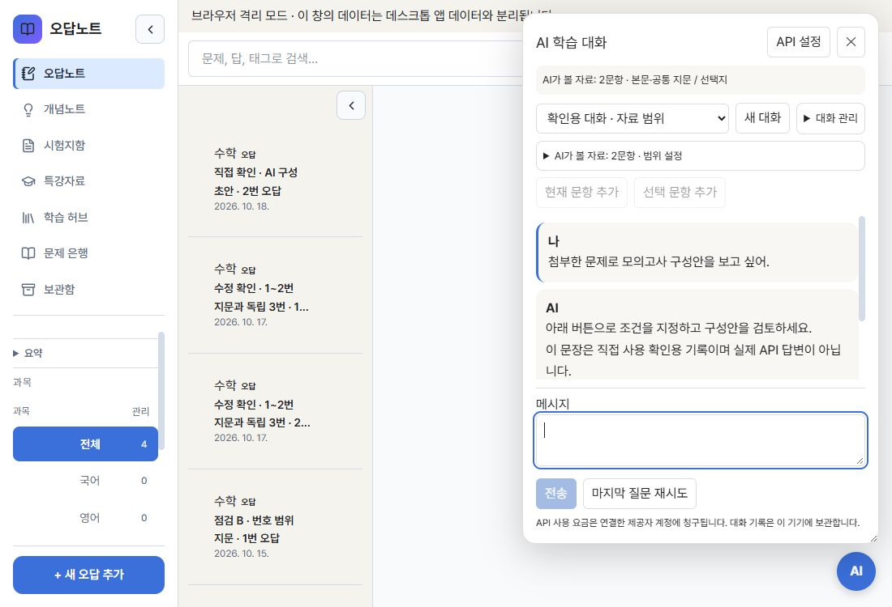
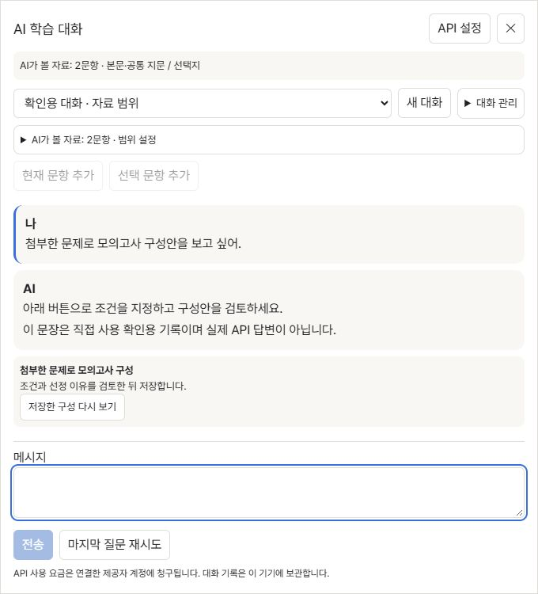
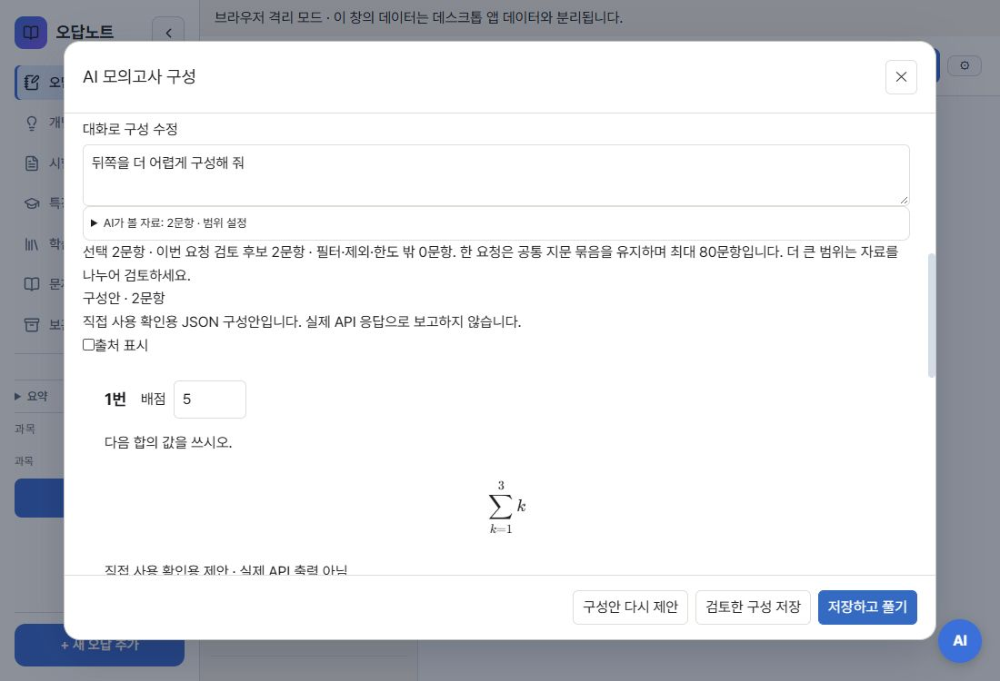

# AI 대화·구성 화면 후속 수정

기준: `main=e46a9aacb4ef6d727bf43800b0dc82055d2f3aab` (#155 병합). 브랜치: `codex/ai-study-ui-followup`.

## 변경

- 대화창 입력·전송 footer를 고정하고 메시지 영역을 독립 스크롤로 구성했다. 자료 설정의 높이를 제한하고 이름 변경·삭제·백업 옵션을 ‘대화 관리’로 모았다.
- 700px 이하의 전체화면 대화창은 모달로 동작한다. 배경의 기존 inert/aria-hidden 값을 보관·복원하고 Tab/Shift+Tab과 외부 포커스를 창 안에 유지한다. 확인/이름 변경 창이 위에 열리면 해당 창의 포커스 처리를 허용한다. Escape/닫기 후 실행 버튼으로 복귀한다. 넓은 화면은 비모달로 유지한다.
- 출처 표시 체크를 구성 미리보기에도 적용했다. 숨김 설정을 저장해도 문항의 source 데이터는 보존한다. 기존 시험 snapshot·인쇄·내보내기는 동일 showSourceReferences 값을 사용한다(연결 코드 검토).
- 출처 글씨를 12px에서 14px로 조정하고, 구성 문항 번호·배점 사이에 간격과 줄바꿈을 추가했다.

## 직접 사용 확인

격리 브라우저의 기존 확인용 자료를 사용했다. 실제 AI 응답이나 실제 PDF 전체 검증으로 간주하지 않는다. 실제 사용자 저장소와 설치판은 사용하지 않았다.

- 1100×750: 자료 설정을 접거나 펼쳐도 입력·전송이 패널 안에 표시된다. 최종 접힌 상태 메시지 높이 202px(수정 전 120px), footer 하단 655px / 패널 하단 672px, 패널 자체 넘침 0px.
- 1100×550: footer 하단 455px / 패널 하단 472px, 패널 자체 넘침 0px. 높이가 낮으면 메시지·설정 스크롤 영역이 먼저 줄어든다.
- 680×750: aria-modal=true, 첫 API 설정 버튼에서 Shift+Tab으로 마지막 재시도 버튼, 마지막 버튼에서 Tab으로 첫 버튼 이동. 이름 변경 창 열기·취소, Escape 닫기와 실행 버튼 복귀 확인.
- 680→1100px 변경 시 비모달 전환과 배경 접근 복원 확인.
- 출처 숨김 시 미리보기 출처가 사라지고 다시 켜면 복원됨. 확인 뒤 기존 체크 상태로 복원했다. 문항 번호와 배점이 붙지 않고 표시됨. 시그마 첨자 정상 표시.
- 임시 탭은 닫았으며 viewport를 복원했다.

## 최소 검사

- 관련 UI 회귀 검사: 초기 두 파일 8개 통과. 최종 재실행에서는 구성 1개가 통과했으나 대화 파일의 forks worker 시작이 응답 시간 초과로 실패했다. 같은 최종 코드에서 대화 파일만 단독 실행해 7개 통과했다. 포커스 순환·배경 복원·Escape·출처 토글·저장 source 보존을 확인했다. 두 파일 최종 동시 실행을 성공으로 보고하지 않는다.
- 워커 오류의 확정 원인은 미확인이다. Node 24.17.0 / npm 11.13.0 / Vitest 4.1.7, 기존 forks 설정을 유지했다. timeout·기대값·skip 변경 없음.
- 변경 파일 ESLint: 오류 0, 기존 StudyAiChat effect 경고 2개 유지.
- CSS 소유권: 3개 통과.
- git diff --check: 통과.
- 빌드: 통과. 기존 큰 chunk 경고 유지.

전체 unit/E2E, Rust/Tauri, 실제 제공자 API 및 Windows 직접 조작은 이번 UI 수정에서 실행하지 않았다. 전체 검증은 사용자의 메모리 제한 요청에 따라 보류한다. 저장 데이터 형식·공유 payload·수식 렌더러 변경 없음.
