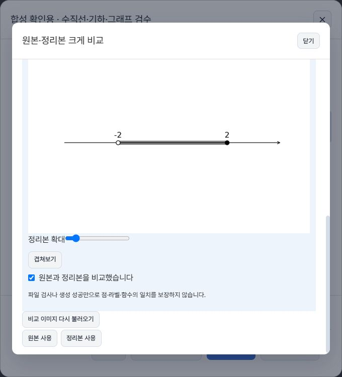

# v7 도형·그래프 PNG 생성과 Import 연동

## 기준과 제출

- 기준 main: `3c5e9b9aeccc3ee77ac755e0ab19ed84cca09416`.
- 독립 worktree/브랜치: `codex/diagram-pipeline-v7`. Draft [#161](https://github.com/reda080201/wrong-answer-notebook/pull/161).
- 기존 Draft #158/#159/#160, 사용자 체크아웃과 실제 앱 자료는 보존했다. 병합·설치판 교체를 하지 않았다.
- 공개 항목/Import-v2 형식은 유지한다. 내부 manifest는 별도이며 일괄 마이그레이션은 없다.

## 원인 → 변경 → 결과

| 층 | 확인한 원인 | 변경과 결과 |
|---|---|---|
| 실제 PNG 생성 | 기존 앱에 재현 가능한 오프라인 생성 CLI가 없으며 구조 데이터만으로 실제 PNG 파일 생성을 대신할 수 없다. | tools/diagram_pipeline의 inspect→render→verify→package, 실제 PNG/원본 crop/manifest/JSON 보고서/ZIP. PDF 영역 렌더→이미지 정리·제한 tracing→명시적 구조 재구성 순서를 지원한다. |
| 패키지·신뢰 | second_pass_model 등 외부 검증 주장이 기본 후보 선택에 영향을 줄 수 있었다. 원본 SHA 선언을 실제 ZIP 바이트와 대조하는 연결도 필요했다. | 외부 승인 제거, 원본 기본·검토 필요, 실제 파일 SHA/디코딩/정확한 참조·ID·페이지·crop 검사. 바이트 일치와 수학적 동일성을 구분한다. |
| 표시·선택 | 가져오기 전 임시 이미지가 저장소 resolver만 사용하면 비교가 깨진다. 인쇄의 선택지 표식은 실제 위치에 그림을 표시하지 않았으며 느슨한 그림을 뒤에 붙였다. | 임시/저장 URL resolver를 전달하고 실제 두 이미지 로드+비교 확인 후 버튼 선택만 보존한다. 본문·선택지·인쇄에서 순서와 명시적 반복을 유지하며 미연결 그림은 위치 경고로 남긴다. |
| 비교 UX | 전체 화면 검토보다 비교창이 뒤에 놓이고 본문의 후보 그림이 작은 첨부 썸네일 크기로 보였다. | 비교 전용 z-index와 큰 Dialog, 2열/680px 세로 배치, 개별 확대·겹치기·재시도·닫기 포커스 복귀, 본문 그림 크기와 정리본 표기 수정. |

## CLI 계약과 안전성

- Python3.12/Windows x64, wheel SHA가 고정된 20개 의존성. 사용자 설치 후 오프라인 실행하며 앱이 Python을 실행하거나 런타임을 번들하지 않는다.
- PDF pypdfium2, Pillow 실제 디코딩, NumPy/OpenCV headless, Matplotlib Agg. 수직선의 열린점/닫힌점/음영, 도형·관계 표시, 명시한 함수·정의역을 지원한다. 보통 표는 table segment를 우선한다.
- 허용 AST를 직접 계산한다. eval/exec/외부 TeX/추정 OCR/AI 호출은 없다. 불연속·정의 불가 표본을 연결하지 않으며 그릴 표본이 없는 함수는 실패한다.
- 원본 입력/페이지/문항 crop/그림 crop과 후보를 별도 보존한다. 검증은 원본 파일에서 페이지를 다시 렌더해 픽셀과 ROI까지 대조한다. 입력·출력 SHA, 코드/폰트/라이브러리/DPI/seed를 기록한다.
- 그림별 단일 worker의 기본60초·1GiB Windows Job Object, 자식 생성 제한, 취소/시간 초과 종료. 이는 worker commit 제한이며 전체 앱 RAM 상한이나 완전한 샌드박스가 아니다.
- traversal/절대·drive 경로/symlink/junction/reparse/서로 다른 기존 출력 덮어쓰기를 거부한다. 이미지25MiB/edge16384/64MP/추정RGBA256MiB, PDF500MiB/300페이지, 객체·윤곽 수 제한.
- worker stderr는 마지막64KiB만 유지한다. ZIP은 자산별로 작성하고 다시 열어 CRC/참조/해시를 검사한 뒤 덮어쓰기 없는 원자적 publish를 한다.
- `verify`는 수학적 동일성을 항상 `not_proven`으로 기록한다. 외부 `confirmed:true`, 보고서, 해시, 모델 주장도 앱 승인 근거가 아니다.

## 사용자 자료와 합성 자료

### 제공 ZIP

- asemblage_s2_06_import_v2.zip:30문항,22원본 JPEG페이지,8그림. 원본/정리본 파일 존재와 실제 디코딩, 선언 원본SHA8/8 일치를 확인했다.
- 실제 브라우저 Import에서30문항·답안30개·그림8개로 검토 화면이 열렸다.12번 원본/후보가 함께 로드됐고 원본 유지로 저장→새로고침 후 항목1개를 확인했다.
- 이 ZIP의 원본 페이지와 기존12번 crop만 사용해 CLI raster_cleanup PNG와 ZIP을 별도로 생성했다. 실제 앱에서 두 이미지를 비교→체크박스→정리본 사용→저장한 뒤 본문의 실제 그림과 사용자 선택 표시를 확인했다.
- 원본 ZIP과 파생 PNG/ZIP/스크린샷은 private scratch/build에만 보관한다. 커밋한 fixture는 합성 자료뿐이다.
- 이는30문항 전체 재작성이나 원문의 수학적 전사 정확성 검증이 아니다. black 수학8회.pdf는 현재 경로에 없어 전체 PDF 대조를 하지 못했다.

### 합성 자료·직접 사용

- 수직선/삼각형/함수 그래프, 실제 PNG 및 Import ZIP을 생성했다. 합성 벡터/회전/스캔 PDF, 다중 페이지와 그림 없는 문항도 검사한다.
- 1100×750/680px 라이트: 원본과 후보 비교, 확대, 좁은 화면의1열 배치(문서 가로 넘침0px), 비교창 닫기와 실행 버튼 포커스 복귀.
- 1번 정리본/3번 원본 선택→저장→재진입/새로고침에서 유지. 명시한 본문→그림→본문과 선택지 반복 참조를 확인했다.
- 격리 브라우저 백업 생성→복원 완료→선택과 실제 그림 유지. 실제 저장소와 네이티브 자료는 건드리지 않았다.
- 실제 ZIP 저장·재로딩 중 UI 도구 응답 지연이 있었다. 이후 완료·항목 수를 확인했으나 설치 앱 성능 개선이나 정확한 RAM 절감 수치로 보고하지 않는다.
- console error0. 확인용 브라우저/서버는 정리했다.

## 회귀 검사와 실행 결과

- 독립 npm ci. 첫 E2E 부팅에서 설치 stamp 누락으로 npm ci가 다시 시작됐다가 중단돼 .bin이 불완전해졌고, 별도 npm ci를 끝까지 실행해 복구했다. 코드나 package-lock 변경으로 덮지 않았다.
- npm run check: unit200파일/1,236개 통과, lint오류0·기존경고55, version/debug/MCP/Tauri/startup/release/CSS 계약과 TypeScript/Vite build 통과.
- Python44개 통과: 실제 PNG→ZIP 재열기, 벡터·회전·스캔 PDF, PNG/JPEG/WebP, AST 거부, 오라벨/선 누락을 수학적 통과로 처리하지 않음, 손상 파일/잘못된 경로/변경된 원본ROI/중복 번호/미배치/타임아웃·취소 종료. Ruff/pip check 통과.
- Python 실행 시간에는 장시간 호스트/도구 정지가 포함돼 정상 처리 성능 수치로 사용할 수 없다.
- 전체 로컬 E2E53개 중51개 통과/2개 실패. 새 CLI ZIP3개(1100/680 저장·재진입, 위조SHA 차단)는 모두 통과.
- 실패1:A4가로1100 연습 화면의 oversized 페이지 수가5초 내0이었다. 실패2:A4가로1920 실전 진입 후 reader 문항 수0, 로그에는 탐색 완료 대기가 있었다.
- 추적을 켠 재실행에서는1100이 oversized 판정을 통과한 뒤 연습의 페이지 끝 이동 중 기존180초 제한을 넘었다. 동일 원인은 아직 확정하지 못했다. 기대값/제한 시간/skip을 바꾸지 않았다. 재실행은 1100 실패/1920 통과(57.9초), 합계 1통과·1실패였다.
- Rust 소스는 변경하지 않았다. 로컬 Rust 재검사는 이번 조건부 범위에 해당하지 않으며 GitHub Rust/Tauri 결과와 구분한다.
- git diff --check 통과. 실제 native touch/설치 앱, OS 인쇄/인쇄PDF 출력의 직접 대조, 강제1GiB 소진 실측은 미확인이다. 인쇄 모델/선택지/자산 선택은 컴포넌트 회귀로 확인했다.

## CI·의존성·라이선스

- head ae2c07f의 [GitHub 실행39749853179](https://github.com/reda080201/wrong-answer-notebook/actions/runs/39749853179): Frontend/E2E/Rust/Tauri/Python 전부성공. 최종 push의 동일 head 결과는 PR 본문에 추가한다.
- 첫 head의 CI YAML 설치 명령에서 :all:가 plain scalar와 충돌해 job 시작 전 실패했다. block scalar로 고쳤고 다음 head의5개 job이 성공했다.
- OSV 공개API에서 고정20개 이름·버전을 조회했다. pytest9.0.2의 UNIX tmpdir 공지 [GHSA-6w46-j5rx-g56g](https://github.com/advisories/GHSA-6w46-j5rx-g56g)를 확인해9.0.3 wheel/해시로 변경했다. 최종 조회 매칭0개. 알려진 공지 조회이며 무취약성을 증명하지 않는다.
- pypdfium2 Apache/BSD 및 실제 고정 Windows wheel의 PDFium/하위18개 고지를 notices/pdfium에 포함한다. Pillow HPND, NumPy BSD, Matplotlib PSF-style/폰트, OpenCV Apache 및 wheel 하위 고지는 README에 기록했다.
- 설치 설명과 명령/manifest 계약은 [CLI README](../../tools/diagram_pipeline/README.md). 런타임 바이너리 재배포를 하지 않으며 이후 번들 시 실제 wheel의 모든 고지를 다시 확인해야 한다.

## 남은 위험·통합

- P0/P1: 이번 확인에서 새 데이터 손실/자동 승인/허용하지 않은 코드 실행은 재현되지 않았다. 이는 미확인 경로의 안전 보장이 아니다.
- P2:A4 로컬 전체 검사 실패의 원인 미확정. 실제 ZIP의 기존 main 수식 미리보기 경고(조건부 함수/조건 문자열 등)와 대량 검토·저장 지연이 남는다. #160의 별도 수식/UI 변경과 구분한다. 실제 PDF 수학적 대조는 불가능했다.
- P3:기존55개 lint경고, 메인JS1932.35kB(gzip572.02kB)/PDF502.93kB chunk경고, entryPaneOverrides 정리는 별도다. #159의 로딩 개선을 이 PR에 포함하지 않았다.
- #160과의 읽기 전용 merge-tree 계산에서 ImportWorkspaceView.tsx와 legacy/11-app-styles.css 충돌을 확인했다. ImportFromGptModal은 자동 결합됐다. 실제 병합 때 resolver/저장 guard와 양쪽 UI 스타일을 함께 보존해야 하며 이번 작업에서 병합하거나 기존 PR을 닫지 않는다.
- **Merge-ready NO**: 로컬 필수 전체 E2E 실패 원인이 미해결이다. GitHub 성공을 로컬 전체 성공으로 대체하지 않는다. 최종 CI/추가 결과는 PR에 기록한다.

## 화면(모두 공개 합성 자료)

