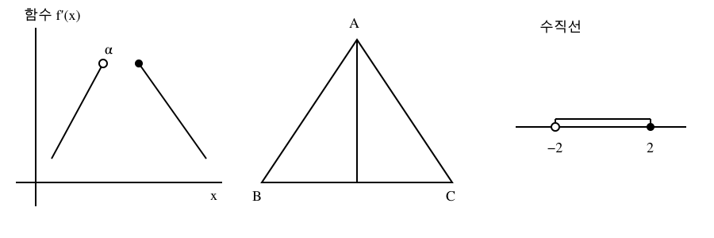

# UI·UX 오류 수정과 Windows SVG 렌더러

## 기준·통합

- main `3c5e9b9aeccc3ee77ac755e0ab19ed84cca09416`의 독립 작업 공간에서 구현했다.
- #160 `9bc5b789`의 가져오기·UI 후속과 #161 `11db672a`의 v7 파이프라인을 통합했다. 기존 원격 PR을 병합하거나 닫지 않는다.
- 충돌한 ImportWorkspaceView는 #160의 편집/복구/미리보기에 #161의 임시 자산 resolver와 FigureReviewCard 선택을 연결했다. legacy/11 CSS는 양쪽 작업실·비교 규칙을 유지했다.
- 사용자 작업 폴더·실제 저장소·원본 시험지는 수정하지 않았다. 새 기능은 기존 Import-v2와 선택적인 내부 SVG 메타데이터를 사용한다.

## 원인 → 수정 → 확인 범위

| 항목 | 원인과 변경 | 확인 |
|---|---|---|
| 해설 안 이미지 확대 | CSS 표시 순서와 Dialog 열림 순서가 달랐다. 실제 열림 때 새 layer를 할당하고 portal backdrop의 표시 순서와 포커스 기준을 일치시켰다. 미리 mount한 닫힌 창도 적용된다. | 중첩·재열기·inert·Escape·포커스 회귀. 직접 화면은 미확인. |
| 확대창 크기/오류 | 공통 카드 폭과 body wrapper가 전체 화면 뷰어에 적용됐고 URL 실패가 null로 사라졌다. 전체 화면 전용 body grid, 부분 실패/실제 img 오류/재시도를 추가했다. 입력 파일이 바뀌면 이전 상태를 폐기한다. | 조회 실패→재시도→확대→img 오류→닫기. |
| 수식 누락 | 파싱·KaTeX 실패가 원문을 지웠다. 원문과 경고를 함께 표시하고, 검수에서는 누른 식의 정확한 UTF-16 원문 범위로 이동한다. 같은 식의 반복도 구분한다. | 잘못된 구분자·미지원 명령·주변 문장·반복 식 수정 위치. |
| 한글 입력 | 공통 prompt가 조합 중 Enter도 확인했다. isComposing/229를 확인하고 입력 이름을 제공한다. | 한글 조합 Enter 유지→명시적 Enter로 한 번 확인. 실제 Windows IME는 미확인. |
| 다크 모드·모서리·폰트 | 정의되지 않은 text/radius 변수를 사용했다. 테마 본문색과 정의된 모서리 토큰으로 정리하고 일반 버튼 14px/compact 13px 규칙을 적용했다. KaTeX 글꼴은 유지한다. | 소스·빌드·CSS 계약 확인. 실제 테마 대비/폰트 로딩은 미확인. |
| 빈 화면/실행 없는 버튼 | 시험지 없는 ‘시험지 열기’, 빈 문제 은행의 필터 초기화, 모의고사 목록의 다음 행동 부재. 자료·검색 실패를 구분하고 가져오기/만들기를 연결했다. 목록 저장 실패 시 만들기로 이동하지 않는다. | 빈 자료 CTA·목록 닫기 실패/재시도·기존 검색/필터 회귀. |
| 불필요한 정보 | 중복 제목, ‘검사기 선택’, 설명 없는 내부 선택 점수. 제목을 정리하고 ‘문항 미리보기’, 접힌 선정 기준 설명으로 바꿨다. | 관련 컴포넌트 회귀. |
| 대량 문항 편집 | 인라인 검수에서 모든 편집기·수식 미리보기를 mount했다. 현재 문항만 편집하고 선택기/이전/다음으로 이동한다. | 30문항 중 article 1개, 마지막 문항 접근·그 문항만 수정. RAM·체감 속도 개선율은 측정하지 않았다. |

## SVG와 Windows 실행

- 기존 v7에는 CairoSVG/scikit-image 의존성이 없었다. 새 경로에도 추가하지 않는다. 기존 전역 Python 패키지를 제거하거나 전역 환경을 변경하지 않는다.
- PyMuPDF **1.28.2**, 실제 Windows abi3 wheel SHA-256 `ebd244918798502d7b4504c90410d1711a4d7675a32584ca30f1bab419ecbffe`를 고정했다. 실행 15개 의존성과 개발/검사 포함 21개 의존성을 분리한다.
- PDFium의 PDF·crop, OpenCV 정리/tracing, Matplotlib Agg 재구성은 유지한다. SVG 원본 또는 명시적 SHA가 있는 SVG 후보를 PyMuPDF로 PNG 렌더링한다. 조용한 resvg fallback은 없다.
- SVG는 UTF-8·절대 viewport/viewBox와 제한된 요소·속성만 허용한다. DTD/entity/NUL/script/foreignObject/image/style 요소, 외부 파일/URL/data, 누락·재귀 참조와 과대 치수를 거부한다.
- 원본 SVG 바이트·페이지·crop과 새 PNG를 구분한다. verify가 SVG 바이트를 확인하고 후보를 다시 렌더해 픽셀을 대조한다. 이는 수학적 동일성 판정이 아니다. 결과는 항상 `not_proven`, 앱에서는 원본 기본·검토 필요다.
- SVG 없는 기존 내부 generation hash는 그대로 계산한다. 기존 Import JSON·저장 데이터 마이그레이션은 없다.
- worker는 절대 bootstrap과 Python `-I`로 실행하여 cwd/PYTHONPATH에서 모듈을 주입하지 못하게 한다. Windows 창 숨김, 기존 60초/1GiB와 전체 자식 종료를 유지한다.
- `build_runtime`은 별도 CPython3.12 runtime/stdlb/실행 wheel/소스/파일 해시를 구성한다. 개발 도구와 사용자 전역 site-packages를 복사하지 않고 앱 시작 시 설치하지 않는다.
- `verify_runtime`은 PATH를 System32로 제한하고 잘못된 PYTHONHOME/PYTHONPATH와 다른 cwd에서 실제 packaged Python으로 inspect→render→verify→package를 수행한다. 이 실행은 PyMuPDF native import 성공, CairoSVG/scikit-image 없음, 원본/선택 정책 유지를 확인했다.
- 합성 PNG의 한글·그리스 문자·프라임·열린점/닫힌점과 끊긴 선을 실제 파일로 확인했다. 그림 파일/라벨 영역 검사와 눈으로 보는 확인을 수학적 동일성 증명으로 보고하지 않는다.

## 라이선스·배포 제한

PyMuPDF wheel은 AGPL-3.0 / Artifex commercial 이중 라이선스를 명시한다.
상용 라이선스를 구매하거나 프로젝트 라이선스를 바꾸지 않았다. 런타임 결과는
`releaseApproved:false`인 **배포 구조 검증용**이며 공식 NSIS 설치파일에 포함하지 않는다.
정식 포함 전 Python·MuPDF·폰트·wheel 하위 바이너리의 재배포 조건과 고지를 확인해야 한다.
[공식 안내](https://pymupdf.readthedocs.io/en/latest/about.html#license-and-copyright).

현재 지원 기준은 Windows x64 / Python3.12다. 로컬 Python3.15의 PyMuPDF 설치 사실과
전체 파이프라인 호환성은 다르며, 3.15 결과는 별도로 기록한다. GTK/Cairo 설치나
소스 빌드로 실패를 우회하지 않는다. 앱 내 실행 버튼·설치판 교체는 이번 범위 밖이다.

## 검사 결과와 미확인

- 독립 npm ci 및 해시 고정 Python3.12 venv 설치 완료.
- UI 관련 12개 파일/105개 통과. 수식 위치 이동 추가 후 관련 5개 파일/33개 통과.
- Python 파이프라인 66개 통과(291.30초). 재귀 clip 거부 추가 후 최신 SVG 23개 통과(23.82초). 전체 앱 검사와 E2E는 요청대로 보류한다.
- 전체 lint는 오류 0·경고 53. 기존 hook 경고를 일괄 수정하거나 숨기지 않았다.
- 초기 TypeScript 검사에서 병합 후 쓰이지 않은 그림 resolver를 발견했고 실제 그림 비교에 연결해 수정했다.
- 최종 TypeScript/Vite 빌드·CSS 계약·런타임 재확인을 통과했다. 원격 PR/CI 결과는 PR 본문에 기록한다.
- 브라우저 도구의 URL 정책 차단과 1495 리스너 부재로 새 직접 UI 캡처·1100/680px 조작은 확인하지 못했다. 차단을 다른 브라우저나 자동화로 우회하지 않았다.
- 설치 앱·실제 터치·전체 원본 PDF 대조·깨끗한 VM에서의 설치는 미확인이다. 배포 probe의 격리 프로세스 검증을 설치 앱 직접 검증으로 대체하지 않는다.
- 남은 P2: 직접 UI 확인과 체감 성능 측정, #161에서 기록한 로컬 A4 E2E 실패의 재확인은 보류 상태다. P3: 나머지 hook 경고/번들 경고/entryPaneOverrides.
- 이번 확인에서 새 P0/P1 데이터 손실을 재현하지 않았다. 미확인 경로의 안전을 보장하는 뜻은 아니다.

**공식 배포 승인 NO. 직접 UI와 전체 검증이 미완료이므로 Merge-ready YES로 보고하지 않는다.**

## 최종 런타임 확인

- 최종 코드로 만든 별도 런타임에서 전체 PNG/ZIP 절차를 재확인했다. PyMuPDF 1.28.2 native import 성공, CairoSVG/scikit-image 없음, 시스템 Python과 다른 cwd 의존 없음.
- 이 합성 입력의 Windows probe 실행 시간은 inspect 1.365초 / render 5.908초 / verify 1.884초 / package 2.040초였다. 앱 UI 속도나 일반 성능 개선율을 뜻하지 않는다.
- Python 3.15.1에서도 SVG adapter 단독으로 같은 900×300 PNG를 생성했다. Python3.15 전체 파이프라인 지원을 검증한 결과가 아니다.
- 최종 PNG: 

- 소수 viewport에서도 가로·세로 축을 독립적으로 늘리지 않도록 단일 배율을 적용하며, 실제 native Matrix를 관찰하는 회귀를 추가했다. 최신 SVG 검사는 23개 통과했다.
- 최종 런타임의 Python 소스를 현재 작업본으로 갱신하고 파일 해시를 다시 기록한 뒤, 별도 출력 디렉터리에서 전체 PNG/ZIP 절차를 다시 통과했다. 공식 설치판 또는 배포 바이너리는 만들지 않았다.
- 변경 TypeScript/TSX 19개 파일 최종 lint: 오류 0, 기존 경고 5. 앞선 전체 lint는 오류 0/경고 53이었다.
- TypeScript/Vite build와 CSS 소유권 3개 통과. 메인 JS 1770.46kB(gzip527.26kB), PDF chunk502.93kB 경고는 유지한다. 경고 한도를 늘리거나 전체 속도 개선으로 해석하지 않는다.

- 최종 관련 UI 13개 파일/108개 통과(73.25초), 변경 파일 lint 오류 0, 최종 TypeScript/Vite build 통과(16.66초). 테스트 삭제/skip/시간 제한 증가 없이 확인했다.
- 최종 버전은 동일 배율 SVG 및 기존 내부 해시 호환을 포함한다. 앞선 66개 검사와 최신 SVG 23개 검사는 중복되므로 합산하지 않는다.
- 이전 검증용 build 폴더 3개의 정리를 시도했으나 자동 승인 검토가 정책상 차단했다. 삭제 명령은 실행되지 않았고, 폴더는 Git 제외된 작업 공간에 남아 있다. 다른 삭제 방식으로 우회하지 않았다.
